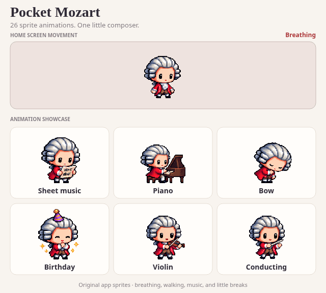

# Pocket Mozart 2.7

A little Mozart companion for Android.

[Download APK 2.7](https://github.com/VvolodyaH/pocket-mozart/raw/refs/heads/main/downloads/Pocket-Mozart-2.7.apk) · [Download the complete source ZIP](https://github.com/VvolodyaH/pocket-mozart/raw/refs/heads/main/downloads/Pocket-Mozart-2.7-source.zip) · [Release notes](https://github.com/VvolodyaH/pocket-mozart/releases/tag/v2.7.0) · [Verification report](VERIFICATION.md)

The APK uses the same signing certificate as earlier versions. Choose **Update** when installing over an existing copy.

Pocket Mozart is a native, transparent, resizable Android home screen widget featuring a chubby pixel-art Mozart. It includes 26 activities: walking, playing instruments, composing, reading, enjoying tea, and taking little breaks. Twenty additional animation sets provide 80 dedicated frames, with musical notes appearing occasionally. The launcher draws the character inside the widget's own area.

## Animation preview



The top panel shows the widget's movement cycle; the tiles cycle through all activity animations. The preview panels provide contrast, while the Android widget has a transparent background.

## Installation and placement

Requires Android 8.0 or later. The downloadable APK is a signed development build that you can install directly.

1. Install `Pocket-Mozart-2.7.apk`. To replace an earlier version, including 2.6, choose **Update**. The package name and signing certificate are unchanged.
2. Open **Pocket Mozart**, tap the button to add Mozart to the home screen, and confirm placement in your launcher.
3. Place the widget and resize its edges on the home screen. Mozart starts automatically.

To prevent accidental app launches, enable the touch-lock toggle directly below the add/pause buttons. Tapping Mozart or the transparent widget area will no longer open the app; animation continues. The setting applies immediately to all placed widgets and is saved. Use the app icon to change settings or unlock touches. Touch locking is off by default.

No accessibility, overlay, or notification permissions are required. The accessibility service from the original overlay version has been removed. There is no mandatory configuration screen or separate area editor.

If your launcher does not support adding the widget from the app, go to the home screen and select **Widgets → Pocket Mozart**. You can also add it directly from the launcher's widget picker.

On Android 12+ launchers, the default size is 2×2 cells. The widget can resize horizontally and vertically, down to the launcher's single-cell limits. Your launcher controls when resize handles appear and which sizes are available during placement. On Samsung, long-press the widget if necessary. The home screen grid reserves its area, as it does for any other widget.

Tap an unlocked widget to open the app. Pausing Mozart displays a still pose; resuming starts animation again. Settings apply to every widget, while each widget has its own random choices.

## Animations and customization

| Activity | Animation |
| --- | --- |
| Idle | The torso rises and falls slightly while the feet stay still |
| Walking | Eight poses with alternating legs, bent knees, and lifted feet; faces left when moving left |
| Sheet music | Reads a musical score |
| Piano | Plays a small piano inside the widget area |
| Bow | Gives a theatrical bow |
| Birthday | Wears a purple-and-gold party hat, with applause and sparkles |

The **20 additional activities** are violin, conducting, flute, quill writing, humming, tea, reading, a letter, a pocket watch, adjusting the wig, a minuet, stretching, yawning, napping, waving, a tricorn hat, a rose, a music box, a travel case, and applause. Each set contains four distinct frames generated from the original character reference.

Walking uses eight frames; other activities use four. The additional sets play forward and backward to avoid jumping from the last frame to the first. Step timing follows the distance traveled. The entire sprite, including props such as the piano and party hat, stays inside the widget.

Breathing uses the original character's pixels. The upper body rises a few pixels and returns over a two-second cycle. The feet retain exactly the same pixels in every idle frame. The violin repair removes the isolated fragment in frames 1 and 3 without changing any character or instrument pixels.

The cycle is always **idle → walk to a random destination → idle → random activity → idle**, then repeat. Mozart reaches the destination before stopping and pauses before the activity. Pose changes are immediate; the character stays fully opaque, without crossfades.

The most recent walking direction applies to idle, every activity, and all props. After moving left, the piano, score, party hat, and other poses remain mirrored inside the same cell, preserving position and size. Direction changes only when a new walk has horizontal movement. If the character fills the entire widget, walking happens in place with animated legs.

Selections in the app preview are queued for the next activity slot, after walking and resting. Rapid selections replace the queued activity. Birthday animations follow the same complete cycle.

A small gold, pink, or lilac musical note occasionally appears, sometimes as a pair. It rises for 2.4 seconds and fades away. Effects use a separate random stream from walking paths. All effects remain inside Mozart's cell, even in short widgets.

You can choose a character size from 64 to 160 dp, three speeds, an optional border, and special-date events. Mozart automatically scales down in small areas. The widget plays approximately **8 frames per second** with energy saving enabled, or **12 frames per second** with it disabled. Actual smoothness depends on the launcher and device. The in-app preview uses 12 and 24 frames per second, respectively.

The party hat appears periodically on **January 27**. The piano appears more often on **September 30** and **October 29**, marking the premieres of *The Magic Flute* and *Don Giovanni*. On **December 5**, Mozart prefers sheet music. Dates use the phone's local calendar and refresh during standard widget updates or settings changes. Preview buttons let you try every activity on any day.

Historical references: [Mozarteum Foundation](https://mozarteum.at/en/wolfgang-amade-mozart), [The Magic Flute in the Köchel catalogue](https://kv.mozarteum.at/en/work/die-zauberflote-the-magic-flute-singspiel-grand-opera-in-2-acts-7137?tab=structure), and [the critical edition of Don Giovanni](https://dme.mozarteum.at/DME/objs/pdf/nma_68_-27_-3_eng.pdf).

## How random sequences work

On **Android 12 and later**, version 2.7 prepares the complete playback sequence inside the launcher. It no longer requests the next frame from a service while you return to the widget's home screen page. That request could display an empty loading view even after the version 2.5 fix.

`ResidentTimeline` prepares random paths and activities using the same `MotionEngine`. The final walk returns Mozart to his starting position, followed by idle and an activity. Playback then wraps to the opening idle. Position, facing direction, and breathing remain consistent at the boundary. Musical notes finish before the wrap, and the character remains fully opaque. Very large areas limit the route to a distance that can be covered within the available time.

**The resident sequence is finite and repeats.** Its seed changes with the local date, so the first update of a new day prepares a different route. Each widget has its own seed. Activities are chosen from the complete catalogue, but a single sequence may include only some of them. With one or two size variants, playback generally lasts around one to three minutes. The total budget is 1600 frames, divided among variants. This tradeoff eliminates service-loading delays; version 2.6 instead continued making new random choices without a short repeating sequence.

Android 12/12L uses one `ViewFlipper` with stable child views already installed, without nested timers. Hidden frames are not measured on every change. Android 13+ uses `RemoteCollectionItems` and an `AdapterViewFlipper`: all items are resident, with views created as needed. This distinction avoids repeatedly serializing application metadata on Android 12. Separate layout IDs replace the previous player when upgrading from 2.6.

Android 8–11 retains `WidgetFramesService`, with immutable batches of roughly four seconds, bounded caching, and checkpoints. It keeps the version 2.5 fix for unnecessary invalidation after resuming, but can still show the transparent loading view when the next frame is missing. The elimination of service-loading delays applies to Android 12+.

Touch locking preserves the current position and frame when views are reapplied. Android 12 reuses stable child IDs; other versions retain their adapter. All poses mirror inside their own cell, and sprites remain transparent with pixel filtering disabled.

Up to four launcher-provided size variants are supported. When more are supplied, the renderer uses the native landscape/portrait pair. Resizing prepares a sequence for the new area. Ordinary updates on the same day preserve numbered frames and the current position when configuration is unchanged. Changing the area, speed, character size, playback mode, or date can start a new route. Position restoration after a full launcher restart depends on the launcher.

The widget belongs to its home screen page. Hiding the window suspends the timer; launchers may have their own policies for off-screen pages. The app works offline, without accounts, analytics, overlay permissions, or accessibility permissions. Native periodic updates remain at 30 minutes. No foreground service is used.

## Building

Open the project in Android Studio, or use JDK 17 and Android SDK 35:

```bash
./gradlew :app:assembleDebug :app:testDebugUnitTest :app:lintDebug
```

The APK is generated at `app/build/outputs/apk/debug/app-debug.apk`. Configure `ANDROID_HOME` or your own `local.properties`, which is excluded from distributed sources. The project uses Java 17, Gradle 8.10.2, and Android Gradle Plugin 8.7.3, with no external runtime libraries.

## Assets and code

- `app/src/main/assets/sprites/mozart.png`: activity atlas, RGBA 1024×1536, with 256×256 cells.
- `app/src/main/assets/sprites/mozart-walk.png`: eight walking poses, RGBA 1024×512.
- `app/src/main/assets/sprites/mozart-extra-0.png` through `mozart-extra-3.png`: four 1024×1280 atlases for the additional sets, suitable for older devices' texture limits.
- `app/src/main/res/drawable-nodpi/sprite_*.png`: 116 native resources, including eight left-facing walking poses; pixels match the atlas cells.
- `app/src/main/res/drawable/pixel_note_*.xml`: three transparent pixel-art musical symbols.
- `art/mozart-extra.png`: complete atlas of the 80 additional frames, for export and preview.
- `art/catalogo.png`: a visual catalogue of all 26 activities.
- `art/reference.jpg` and `art/mozart*-generated.png`: reference and generated images before import.
- `art/mozart-preview.gif`: a 24-second looping showcase of all 26 animations, rendered from the app sprites and motion engine.
- `art/anteprima.html`: offline browser sprite preview. It supports pose and size controls but does not simulate the Android service, launcher cache, or resident sequence.
- `ResidentTimeline.java`, `MotionEngine.java`, `WidgetTimeline.java`, and `WidgetClipStore.java`: motion, numbered frames, dates, bounded caching, and checkpoints.
- `NativeWidgetRenderer.java`, `PixelSprites.java`, and `WidgetFramesService.java`: native frame construction and delivery.
- `MozartWidgetProvider.java`: placement, updates, and resizing.
- `PetSceneView.java` and `SpriteAtlas.java`: in-app preview.

To regenerate native resources from the included atlases:

```bash
java -Djava.awt.headless=true tools/BakeSpriteFixes.java .
java -Djava.awt.headless=true tools/ExportWidgetFrames.java .
python3 tools/validate_assets.py
python3 tools/make_preview.py
```

The importers `CompileSprites.java`, `CompileWalkSprites.java`, and `CompileExtraSprites.java` preserve the original generated-image preparation process. After import, `BakeSpriteFixes.java` builds the breathing frames from original pixels and applies only the transparent repair area for the violin. The rig fixes foot pixels in place and moves the upper body using nearest-neighbor sampling. `CompileExtraSprites.java` also reapplies the patch, preventing reimport from restoring the fragment. `art/mozart-idle-reference.png`, the original affected frames, and the generated repair image make the changes inspectable.

To regenerate the README GIF, install JDK 17, FFmpeg, Chromium, and the Python `playwright` package, then run:

```bash
python3 tools/make_readme_gif.py
```

## Verification

Build, JUnit/Robolectric tests, and lint results are documented in [VERIFICATION.md](VERIFICATION.md). Tests cover API levels 26, 31, and 35, both resident players, the previous player's cache, geometry, continuity, resources, placement, and migration. Samsung launcher transitions, device memory use, and power consumption still require testing on a physical phone.
